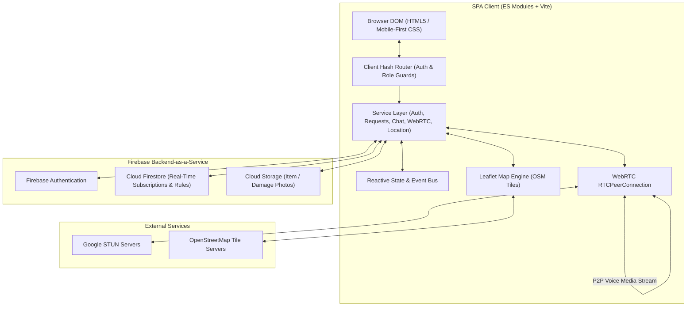

# ShareBox System Architecture & Engineering Specifications

## 1. High-Level Architecture

ShareBox is architected as an autonomous Single Page Application (SPA) built with vanilla ES Modules and styled with custom CSS design tokens. It interfaces with Firebase v10+ modular services for authentication, document persistence, and binary media storage.

---

## 2. WebRTC Peer-to-Peer Voice Calling & Firestore Signaling

Voice communication operates directly peer-to-peer over an audio-only stream. Signaling (SDP offers, answers, and ICE candidates) is coordinated through Firestore documents.

### Signaling Document Schema
- Collection: `/calls/{callId}`
  - `status`: `"calling"` | `"ringing"` | `"accepted"` | `"rejected"` | `"ended"`
  - `offer`: `{ type: "offer", sdp: string }`
  - `answer`: `{ type: "answer", sdp: string }`
- Subcollections:
  - `/calls/{callId}/callerCandidates/{id}`: Ice candidates emitted by caller
  - `/calls/{callId}/calleeCandidates/{id}`: Ice candidates emitted by callee

### Lifespan & Teardown
When either party terminates the call or closes the tab, the call document status is set to `"ended"`, the local media stream tracks are stopped, and the candidate subcollections are deleted to keep the database tidy.

---

## 3. Privacy-First GPS Location Assistance

A central tenet of ShareBox is safeguarding student privacy:
1. **Zero Continuous Tracking**: The application never registers background watch listeners (`watchPosition`).
2. **On-Demand Only**: Location coordinates are queried only upon the user explicitly tapping the **"Suggest meeting point"** button.
3. **One-Shot Coordinate Query**: `navigator.geolocation.getCurrentPosition` is invoked once with high accuracy enabled.
4. **Ephemerality**: Raw individual user positions are never persisted to Firestore. Only the final mutually agreed meeting point label and coordinates are saved to the request document.
5. **Campus Landmarks & Draggable Pin**: In the event of GPS denial or indoor signal attenuation, users can select an admin-managed landmark from a dropdown or drag the meeting pin directly on the map.
