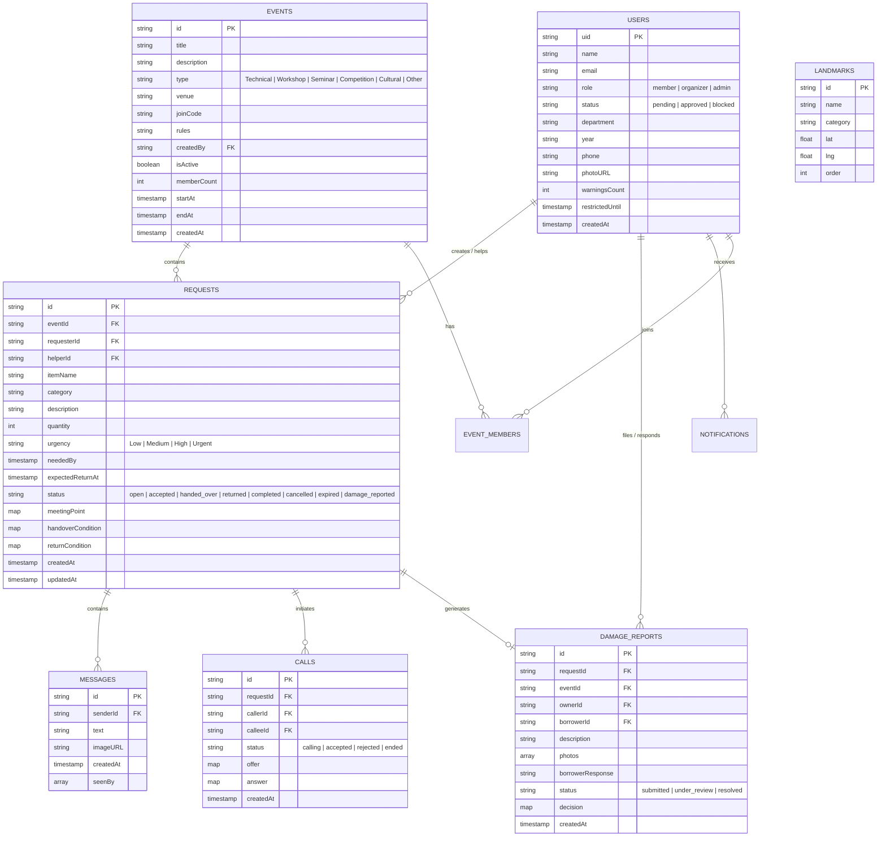

# ShareBox Data Model & Firestore Schema Reference

## 1. Entity-Relationship Overview

ShareBox utilizes Google Cloud Firestore as a NoSQL document database structured for real-time synchronization, atomic status transitions, and role-based privacy.

## 2. Collection Schemas

### `users/{uid}`
Stores student, organizer, and administrator profiles.
- **Constraints**:
  - `email` must match the institution domain (`@college.edu`).
  - `status` defaults to `pending` until approved by an administrator.
  - `restrictedUntil` blocks borrowing and lending when in the future.

### `events/{eventId}`
Organized campus events (hackathons, labs, symposiums) and the default `campus-general` community.
- **Rules Text**: Used by organizers/admins to adjudicate damage reports.
- **Join Code**: 6-character code required for private event participation.

### `requests/{requestId}`
Core resource coordination entity with strict state transitions:
1. `open`: Available for acceptance by any event member.
2. `accepted`: Assigned to a helper via atomic Firestore transaction.
3. `handed_over`: Physical possession transferred and verified by both parties.
4. `returned`: Item returned by borrower.
5. `completed`: Confirmed in good condition by lender.
6. `damage_reported`: Lender logged damage or missing equipment.

### `requests/{requestId}/messages/{msgId}`
In-app real-time chat between requester and helper. Subcollection ensures queries are bounded strictly to the relevant exchange.

### `calls/{callId}`
WebRTC signaling document containing SDP offer/answer and subcollections for ICE candidates (`callerCandidates` and `calleeCandidates`).

### `damageReports/{reportId}`
Dispute resolution records capturing photographic evidence, borrower rebuttal, and organizer/admin punitive actions.
